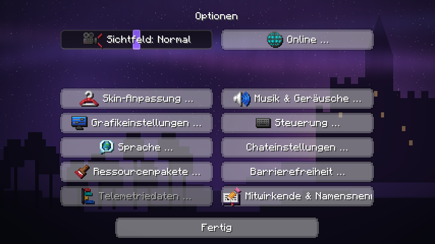

# Lumora Button-Design

Minecraft-Knöpfe im Stil Blackout, Hyperium, Liquid, Lunar, PvPClient oder Rounded, optional mit Schatten. Der Stil „Lumora“ lässt die Knöpfe unverändert.

Eingebautes Addon des Lumora Clients (Id `lumora-buttons`, im Spiel: Lumora-Hub → Addons). Läuft in allen 18
unterstützten Minecraft-Versionen (1.8.9 bis 26.3). Standard: **an (Stil „Lumora“)**.

> Dieses Repository ist eine **Kopie zum Lesen und Nachschlagen**. Das Addon ist Teil des Clients, weil es an
> Minecraft-Stellen andockt, die sich je Version unterscheiden. Gebaut, getestet und ausgeliefert wird es in
> [LumoraClient/lumora-launcher](https://github.com/LumoraClient/lumora-launcher). Eigene Addons baust du mit dem
> [Addon-Template](https://github.com/LumoraClient/lumora-addon-template).

## Einstellungen

| Schlüssel | Bedeutung |
|---|---|
| `style` | Stil |
| `shadow` | Schatten (Blackout, Hyperium, Rounded) |

## Aufbau

| Ordner | Inhalt | Im Haupt-Repository |
|---|---|---|
| `src/` | Das Addon (versionsunabhängig, nur Lumora-API und Lumora-Core) und die gemeinsamen Helfer, die es braucht | `lumora-core/src/main/java/dev/lumora/core/` |
| `hooks/<version>/` | Die Andockstellen je Minecraft-Version (Mixins und Adapter) | `client/mc<version>/src/main/java/dev/lumora/client/` |
| `tests/` | Unit-Tests (laufen im Haupt-Repository) | `lumora-core/src/test/java/` |

## Lizenz

GPL-3.0-or-later (siehe `LICENSE`), wie der ganze Lumora Client.

Stile nachgebaut nach FDPClient `features/module/modules/client/button` (GPL-3.0, SkidderMC, auf Basis von LiquidBounce von CCBlueX), auf Lumoras HudGraphics neu geschrieben.
